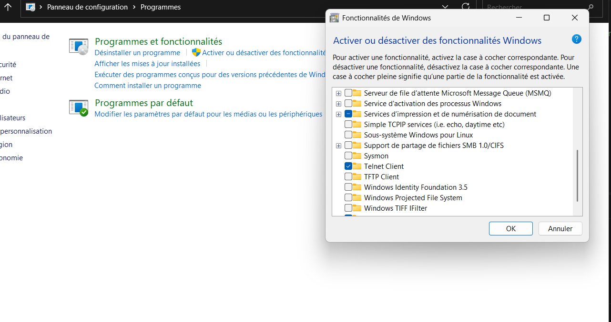
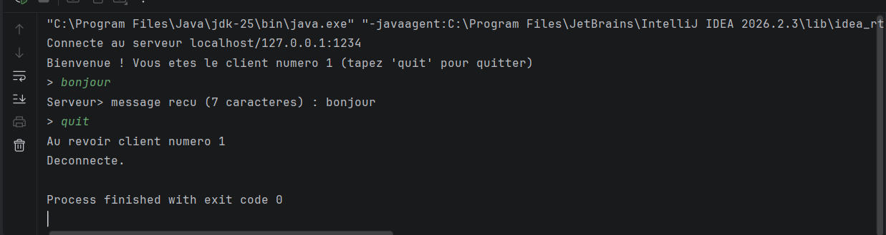
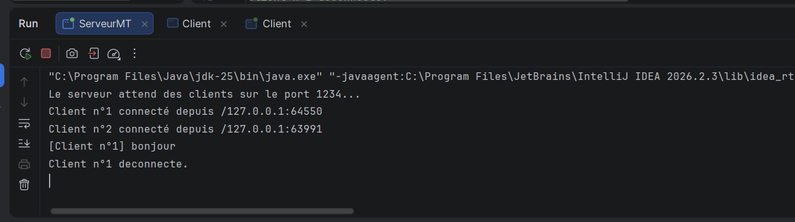

# TP3-DAR2026 — Serveur multi-threads (sockets TCP)

**Matière** : Développement d'applications réparties — LSI3 — FSS 2026-2027
**Activité 3-1** : Acceptation de plusieurs clients
**Auteur** : *Maymana Amara*

## 1. Objectif
Transformer le squelette Client/Serveur des TP1/TP2 (un seul client par exécution)
en un **serveur multi-threads** capable de traiter plusieurs clients simultanément.

## 2. Structure du projet
```
TP3-DAR2026/
├── src/
│   ├── ServeurMT.java      # thread principal : ServerSocket + boucle accept()
│   ├── ClientProcess.java  # un thread par client (socket de service)
│   └── Client.java         # client TCP (InetAddress + InetSocketAddress)
├── .gitignore
└── README.md
```

## 3. Principe
1. `main()` démarre le thread `ServeurMT`.
2. `run()` crée le `ServerSocket` (port **1234**) puis boucle sur `accept()`.
3. À chaque connexion, le serveur :
    - incrémente un compteur thread-safe (`AtomicInteger`) → **numéro d'ordre** ;
    - affiche l'adresse IP du client (`socket.getRemoteSocketAddress()`) ;
    - crée et démarre `new ClientProcess(socket, numero).start()` puis retourne à `accept()`.
4. `ClientProcess.run()` :
    - envoie au client son **numéro d'ordre** ;
    - lit chaque ligne (`BufferedReader.readLine()`) et répond (`PrintWriter.println`, autoflush) ;
    - se termine sur `quit` ou à la déconnexion du client, puis ferme la socket.

> Il faut appeler `start()` (et non `run()`) : sinon aucun nouveau thread n'est créé
> et le serveur reste bloqué sur le premier client.

## 4. Compilation et exécution
```bash
# Compilation
javac -d out src/*.java

# Terminal 1 : serveur
java -cp out ServeurMT

# Terminal 2, 3, ... : clients Java
java -cp out Client                    # localhost:1234
java -cp out Client 192.168.1.20 1234  # serveur distant (réseau local)
```
Avec un IDE IntelliJ : créer le projet `TP3-DAR2026`,
copier les 3 classes dans `src`, lancer `ServeurMT` puis plusieurs instances de `Client`.

## 5. Tests
### 5.1 Tests locaux
**a) Clients Telnet** : `telnet localhost 1234` (dans plusieurs invites de commande).
> Activer Telnet sous Windows : Panneau de configuration → Programmes →
> Activer ou désactiver des fonctionnalités Windows → *Client Telnet*.



**b) Clients Java** : lancer plusieurs fois `Client`.



Sortie serveur observée lors de mes essais :
```
Le serveur attend des clients sur le port 1234...
Client n°1 connecté depuis /127.0.0.1:53040
Client n°2 connecté depuis /127.0.0.1:53042
[Client n°2] salut
[Client n°1] bonjour
Client n°1 deconnecte.
Client n°2 deconnecte.
```
Sortie d'un client :
```
Connecte au serveur localhost/127.0.0.1:1234
Bienvenue ! Vous etes le client numero 1 (tapez 'quit' pour quitter)
> bonjour
Serveur> message recu (7 caracteres) : bonjour
> quit
Au revoir client numero 1
Deconnecte.
```

### 5.2 Tests en réseau local
1. Machine **serveur** : lancer `ServeurMT`, relever l'IP (`ipconfig` / `ifconfig`),
   autoriser le port 1234 dans le pare-feu.
2. Machines **clients** (même réseau) : `java -cp out Client <IP_du_serveur> 1234`.
3. Le serveur affiche l'IP de chaque machine cliente.



## 6. Synthèse
- **Problème** : avec un seul `accept()`, le serveur ne sert qu'un client ; les autres attendent puis échouent.
- **Solution** : boucle `while(true)` sur `accept()` + **un thread `ClientProcess` par client**.
  La boucle seule ne suffit pas : il faut un objet `Thread` dédié, donc une classe dédiée.
- **Numéro d'ordre** : `AtomicInteger` pour éviter les accès concurrents incohérents.
- **Classe Client** : presque inchangée ; elle utilise `InetAddress`/`InetSocketAddress` pour cibler un serveur distant.
- **Limites** : un thread par client coûte en mémoire → en production, utiliser un *pool de threads*
  (`ExecutorService`).
